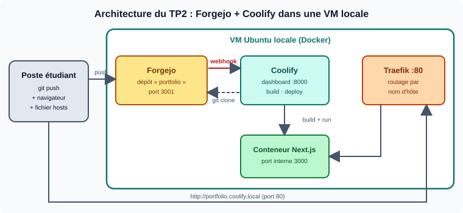

# TPs Master DevOps & Cloud : déployer un portfolio Next.js

Deux approches pour déployer la même application. Les deux TP s'exécutent **en local, dans des machines virtuelles** : aucun nom de domaine n'est nécessaire. Le TP3 construit ensuite un pipeline CI/CD complet dans le cloud avec GitHub Actions et Render.

| TP      | Outil(s)                | Approche                                                                                                               | Dossier                                                    |
| ------- | ----------------------- | ---------------------------------------------------------------------------------------------------------------------- | ---------------------------------------------------------- |
| **TP1** | Ansible + Semaphore UI  | Infrastructure as Code (playbooks, rôles, interface d'exécution)                                                       | [`tp1-ansible-semaphore/`](tp1-ansible-semaphore/)         |
| **TP2** | Coolify + Forgejo       | PaaS auto-hébergé (alternative à Heroku / Netlify / Vercel) avec forge Git locale et redéploiement par webhook         | [`tp2-coolify/`](tp2-coolify/)                             |
| **TP3** | GitHub Actions + Render | Intégration continue (vérification des pull requests, ruleset) et déploiement continu après CI, avec prévisualisations | [`tp3-github-actions-render/`](tp3-github-actions-render/) |
| **TP4** | Ansible                 | Bases d'Ansible : inventaire, playbook idempotent, clés SSH, Jenkins/Docker/Portainer, rôles                           | [`tp4-ansible-bases/`](tp4-ansible-bases/)                 |
| **TP5** | Vagrant (+ Ansible)     | Environnements de lab reproductibles (virtualisation imbriquée, Vagrantfile, provisionnement Ansible)                  | [`tp5-vagrant/`](tp5-vagrant/)                             |
| **TP6** | Terraform (+ Vagrant, Ansible) | Infrastructure as Code déclarative (provider Docker local/SSH), puis intégration Vagrant → Ansible → Terraform  | [`tp6-terraform/`](tp6-terraform/)                         |

Les TP4 à TP6 forment une série d'initiation aux outils d'automatisation (Ansible, Vagrant, Terraform) ; ils s'exécutent eux aussi dans des VM locales.





## Structure du dépôt

```
.
├── README.md
├── .gitignore
├── tp1-ansible-semaphore/
│   ├── README.md
│   ├── TP.md
│   ├── portfolio-deploy/      ← squelette Ansible à compléter
│   ├── images/
│   └── captures/
├── tp2-coolify/
│   ├── README.md
│   ├── TP.md
│   ├── forgejo/docker-compose.yml
│   ├── images/
│   └── captures/
├── tp3-github-actions-render/
│   ├── README.md
│   ├── TP.md
│   ├── images/
│   └── captures/
├── tp4-ansible-bases/
│   ├── README.md, TP.md
│   ├── images/
│   └── captures/
├── tp5-vagrant/
│   ├── README.md, TP.md
│   ├── images/
│   └── captures/
└── tp6-terraform/
    ├── README.md, TP.md
    ├── images/
    └── captures/
```

## Ordre

1. **TP1** : comprendre l'automatisation « à la main » (rôles, idempotence, Semaphore).
2. **TP2** : découvrir l'approche PaaS, puis comparer les deux (partie D du TP2).
3. **TP3** : automatiser la vérification et le déploiement avec un vrai pipeline CI/CD (GitHub Actions + Render).
4. **TP4** : maîtriser les bases d'Ansible (inventaire, playbooks, clés SSH, rôles).
5. **TP5** : créer des VM reproductibles avec Vagrant et les provisionner avec Ansible.
6. **TP6** : décrire l'infrastructure avec Terraform, puis enchaîner Vagrant → Ansible → Terraform.

> Utilisez un **serveur vierge distinct** pour chaque TP : le TP1 installe Nginx sur les ports 80/443, que Coolify veut gérer lui-même.
