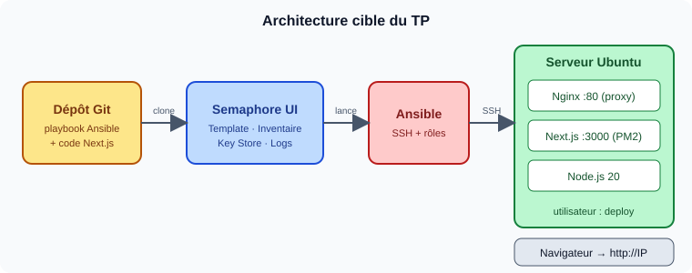

# TP : Déploiement d'un Portfolio Next.js avec Ansible et Semaphore UI

> Master DevOps & Cloud

Déployer un portfolio **Next.js** sur un serveur Ubuntu avec un playbook **Ansible** structuré en rôles, puis industrialiser l'exécution avec **Semaphore UI**.



## Contenu du dépôt

```
.
├── README.md                  ← cette page
├── TP.md                      ← énoncé complet du TP
├── portfolio-deploy/          ← squelette de départ (à compléter)
│   ├── ansible.cfg
│   ├── site.yml
│   ├── inventory/hosts.ini
│   ├── group_vars/all.yml
│   └── roles/
│       ├── common/   (tasks)
│       ├── nodejs/   (tasks)
│       ├── app/      (tasks, handlers)
│       └── nginx/    (tasks, handlers, templates)
├── images/                    ← schémas de l'énoncé
└── captures/                  ← vos captures d'écran (livrables)
```

## Démarrage rapide

```bash
git clone <URL-de-ce-depot>
cd tps-devops-cloud/tp1-ansible-semaphore/portfolio-deploy

# 1. Adapter l'inventaire et les variables
nano inventory/hosts.ini
nano group_vars/all.yml

# 2. Tester la connexion
ansible all -m ping

# 3. Compléter les rôles (cherchez les « TODO »), puis valider
ansible-playbook site.yml --syntax-check
ansible-playbook site.yml --check --diff
ansible-playbook site.yml
ansible-playbook site.yml      # 2e passage : changed=0 attendu
```

Ensuite, passez à la **partie B** (Semaphore UI) dans [`TP.md`](TP.md).

## Prérequis

- Serveur cible Ubuntu 24.04 accessible en SSH par clé
- Ansible ≥ 2.15 et Git sur le poste de contrôle
- Instance Semaphore UI (Docker)

## Livrables

1. Votre dépôt Git avec les rôles complétés et ce README adapté
2. Captures dans `captures/` :
   - `semaphore-template.png`, `semaphore-run.png`, `portfolio.png`, `idempotence.png` (2ᵉ run à `changed=0`)
3. Un rapport d'une page (`RAPPORT.md`).
