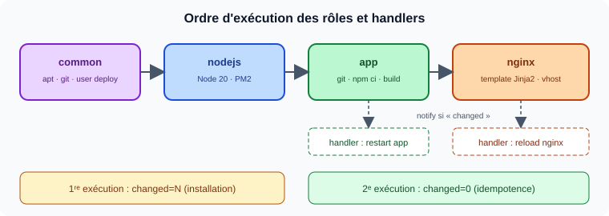
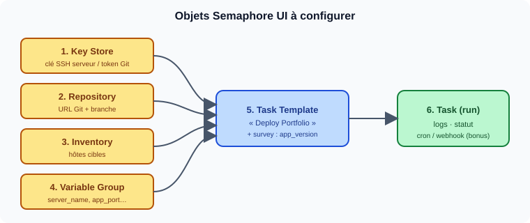
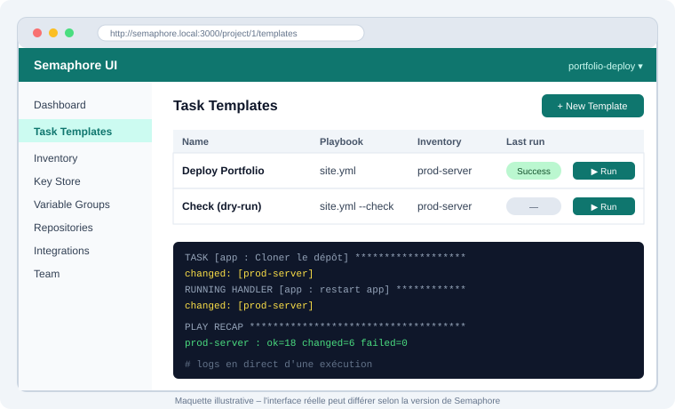

# TP : Déploiement d'un Portfolio Next.js avec Ansible et Semaphore UI

---

## 1. Objectifs pédagogiques

À l'issue du TP, vous serez capable de :

- écrire un playbook Ansible **idempotent**, structuré en **rôles** ;
- automatiser le déploiement d'une application **Next.js** sur un serveur Linux ;
- **industrialiser** l'exécution avec **Semaphore UI** (inventaire, dépôt, clés, templates).

## 2. Prérequis

| Élément           | Détail                                                    |
| ----------------- | --------------------------------------------------------- |
| Serveur cible     | Ubuntu 24.04 (VM ou conteneur), accès SSH par clé         |
| Poste de contrôle | Ansible ≥ 2.15, Git                                       |
| Semaphore UI      | Instance fonctionnelle (Docker)                           |
| Application       | Portfolio Next.js dans un dépôt Git (fourni ou personnel) |

> **Vérification rapide** : `ansible --version` · `ssh deploy@<IP>` · accès à `http://<IP-semaphore>:3000`.

## 3. Architecture cible


Le flux : Semaphore récupère le dépôt Git, exécute Ansible, qui configure le serveur (Node.js, application via PM2, Nginx en reverse proxy).

## 4. Partie A : Playbook Ansible (ligne de commande)

### A.1 Structure du projet

> Un **squelette de départ** est fourni dans [`portfolio-deploy/`](portfolio-deploy/) : complétez les `TODO`.

```
portfolio-deploy/
├── ansible.cfg
├── inventory/
│   └── hosts.ini
├── group_vars/
│   └── all.yml
├── site.yml
└── roles/
    ├── common/tasks/main.yml
    ├── nodejs/tasks/main.yml
    ├── app/
    │   ├── tasks/main.yml
    │   └── handlers/main.yml
    └── nginx/
        ├── tasks/main.yml
        ├── handlers/main.yml
        └── templates/portfolio.conf.j2
```

### A.2 Enchaînement des rôles



### A.3 Travail à réaliser

| #   | Rôle     | Tâches attendues                                                                                               | Modules suggérés                     |
| --- | -------- | -------------------------------------------------------------------------------------------------------------- | ------------------------------------ |
| 1   | `common` | Mise à jour du cache apt, installation de `git`, `curl`, `build-essential`, création de l'utilisateur `deploy` | `apt`, `user`                        |
| 2   | `nodejs` | Ajout du dépôt NodeSource, installation de Node.js et de PM2                                                   | `apt_key`/`get_url`, `apt`, `npm`    |
| 3   | `app`    | Clone du dépôt dans `/opt/portfolio`, `npm ci`, `npm run build`, démarrage sur le port 3000                    | `git`, `command`, `shell`            |
| 4   | `nginx`  | Installation, vhost via template Jinja2 (`proxy_pass` → `127.0.0.1:3000`), activation du site                  | `apt`, `template`, `file`, `service` |

**Contraintes**

- Le redémarrage de l'application ne doit avoir lieu **que si le code a changé** (handler + `notify`).
- Le rechargement de Nginx passe par un **handler**.
- Aucune valeur en dur : utiliser `group_vars/all.yml`.

```yaml
# group_vars/all.yml (à compléter)
app_repo: "https://github.com/<user>/<portfolio>.git"
app_version: "main"
app_dir: "/opt/portfolio"
app_port: 3000
server_name: "portfolio.local"
```

```jinja
# roles/nginx/templates/portfolio.conf.j2 (à compléter)
server {
    listen 80;
    server_name {{ server_name }};

    location / {
        proxy_pass http://127.0.0.1:{{ app_port }};
        # TODO : ajouter les en-têtes Host, X-Real-IP, X-Forwarded-For
    }
}
```

### A.4 Validation

```bash
ansible-playbook -i inventory/hosts.ini site.yml --syntax-check
ansible-playbook -i inventory/hosts.ini site.yml --check --diff
ansible-playbook -i inventory/hosts.ini site.yml
ansible-playbook -i inventory/hosts.ini site.yml   # 2e run
```

**Critère de réussite** : la 2ᵉ exécution affiche `changed=0`.

- [ ] `--syntax-check` OK
- [ ] 1ʳᵉ exécution sans erreur
- [ ] 2ᵉ exécution : `changed=0`
- [ ] Portfolio visible sur `http://<IP>`


## 5. Partie B : Industrialisation avec Semaphore UI

### B.1 Vue d'ensemble



### B.2 Configuration pas à pas

| Étape | Menu Semaphore           | Paramètres                                                           |
| ----- | ------------------------ | -------------------------------------------------------------------- |
| 1     | **Projects → New**       | Nom : `portfolio-deploy`                                             |
| 2     | **Key Store**            | Clé SSH (accès serveur) ; clé/token Git si dépôt privé               |
| 3     | **Repositories**         | URL du dépôt, branche, clé d'accès associée                          |
| 4     | **Inventory**            | Inventaire statique (même contenu que `hosts.ini`), clé SSH associée |
| 5     | **Variable Groups**      | `server_name`, `app_port`… (format JSON)                             |
| 6     | **Task Templates → New** | Playbook `site.yml`, Inventory, Repository, Variable Group           |
| 7     | **Survey Variable**      | Variable `app_version` (branche ou tag à déployer)                   |

Aperçu de l'interface attendue (maquette illustrative : le rendu réel dépend de votre version de Semaphore) :



> **Capture à fournir :** écran du Task Template configuré.
> ``

### B.3 Exécution et vérification

1. Lancer **Deploy Portfolio** depuis l'interface et suivre les logs en direct.
2. Vérifier le portfolio dans le navigateur.
3. Modifier une page du portfolio, **pousser** le commit, relancer la tâche.
4. Constater la mise à jour et le **redémarrage conditionnel** de l'application dans les logs.

> **Captures à fournir :**
> ``
> ``
