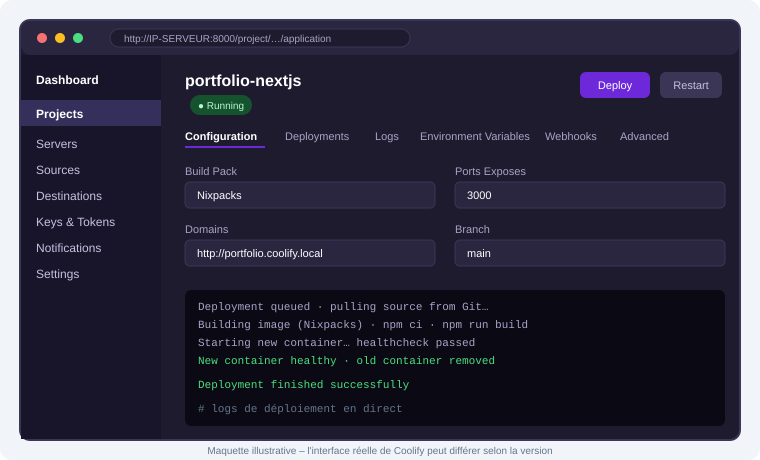
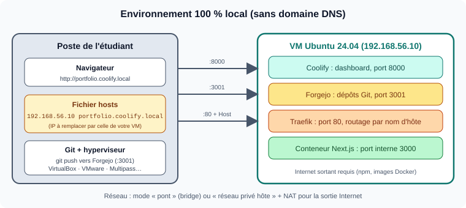
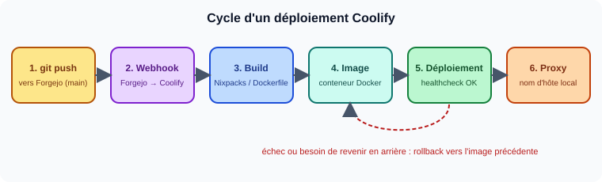
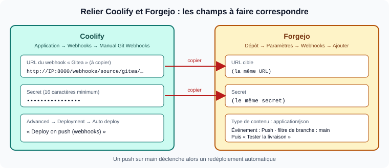

# TP2 : Déploiement d'un Portfolio Next.js avec Coolify et Forgejo

> **Coolify** : alternative open source et auto-hébergeable à Heroku, Netlify et Vercel.
> **Forgejo** : forge Git auto-hébergée (alternative à GitHub).
> Ce TP s'exécute **entièrement en local**, dans une machine virtuelle : **ni domaine DNS, ni compte GitHub**.

---

## 1. Objectifs pédagogiques

À l'issue du TP, vous serez capable de :

- installer **Coolify** et **Forgejo** dans une VM locale ;
- déployer une application **Next.js** depuis un dépôt Forgejo, accessible par un **nom d'hôte local** ;
- mettre en place un **webhook Forgejo → Coolify** : chaque `git push` redéploie automatiquement l'application ;
- pratiquer le **rollback** et **comparer** l'approche PaaS (Coolify) avec l'approche IaC du TP1.

## 2. Présentation des outils

Coolify est un PaaS auto-hébergé : il gère pour vous le **build**, le **déploiement**, le **proxy inverse** et les **bases de données** via une interface web. Forgejo héberge vos dépôts Git et appelle Coolify par **webhook** à chaque push, comme le ferait GitHub.

| Outil                       | Rôle dans le TP                                            |
| --------------------------- | ---------------------------------------------------------- |
| Forgejo                     | Dépôt Git du portfolio ; émet le webhook sur chaque `push` |
| Coolify                     | Clone, construit, déploie et expose l'application          |
| Traefik (intégré à Coolify) | Routage HTTP par nom d'hôte                                |



> Maquette illustrative : l'interface réelle dépend de la version installée.

### 3. Prérequis (environnement local)

| Élément          | Détail                                                                                                                                      |
| ---------------- | ------------------------------------------------------------------------------------------------------------------------------------------- |
| Hyperviseur      | VirtualBox, VMware, Hyper-V, Multipass ou Proxmox sur votre poste                                                                           |
| VM               | **Ubuntu 24.04**, **2 vCPU, 4 Go de RAM recommandés (2 Go minimum), 20 Go de disque**, accès sudo                                           |
| Réseau de la VM  | Une **IP joignable depuis votre poste** (mode pont, ou réseau privé hôte + carte NAT) **et un accès Internet sortant** (npm, images Docker) |
| VM dédiée        | Coolify gère Docker et le proxy sur le port 80 : n'y installez rien d'autre (pas de Nginx du TP1)                                           |
| Poste            | Git installé ; le code du portfolio Next.js du TP1 en local                                                                                 |
| Domaine / GitHub | **Aucun.** Nom d'hôte local via le fichier `hosts`, dépôt hébergé sur Forgejo                                                               |

Ports utilisés dans la VM : `8000` (Coolify), `80` (Traefik), `3001` (Forgejo web), `2222` (Forgejo SSH). Le port `3000` reste interne à l'application Next.js.

## 4. Architecture cible


### Réseau local et nom d'hôte



## 5. Partie A : Installation de Coolify

1. Notez l'IP de la VM : `ip -4 a` (on suppose `192.168.56.10` dans l'énoncé).

2. Depuis votre poste : `ssh <utilisateur>@192.168.56.10`.

3. Lancez l'installation officielle (en `root` ou via `sudo`) :
   
   ```bash
   curl -fsSL https://cdn.coollabs.io/coolify/install.sh | bash
   ```

4. Vérifiez Docker et les conteneurs Coolify : `docker --version` puis `docker ps`.

5. Ouvrez `http://192.168.56.10:8000`, **créez le compte administrateur** immédiatement, puis suivez l'assistant (serveur `localhost`).

6. Laissez l'**URL de l'instance** par défaut : vous accéderez au dashboard par `IP:8000`.
- [ ] Dashboard accessible et compte admin créé
- [ ] Serveur `localhost` en état *Reachable*
- [ ] Proxy démarré (Servers → proxy)

> **Capture à fournir :** `captures/coolify-dashboard.png`

## 6. Partie B : Forgejo et dépôt du portfolio

### B.1 Installer Forgejo

Copiez le fichier [`forgejo/docker-compose.yml`](forgejo/docker-compose.yml) dans la VM, puis :

```bash
docker compose up -d
docker ps          # le conteneur « forgejo » doit être Up
```

Points à comprendre dans ce fichier :

- port web **3001** (le 3000 est réservé à Next.js) ;
- `FORGEJO__webhook__ALLOWED_HOST_LIST=external,private` : **par défaut, Forgejo refuse d'envoyer un webhook vers une adresse privée**. Sans ce réglage, le webhook de la partie D échouera.

### B.2 Configuration initiale

Ouvrez `http://192.168.56.10:3001` et remplissez l'assistant d'installation :

| Champ                  | Valeur                                     |
| ---------------------- | ------------------------------------------ |
| Base de données        | SQLite3                                    |
| Domaine du serveur     | `192.168.56.10`                            |
| URL de base de Forgejo | `http://192.168.56.10:3001/`               |
| Compte administrateur  | À créer (nom, mot de passe, e-mail fictif) |

### B.3 Créer le dépôt et y pousser le portfolio

1. Dans Forgejo : **Nouveau dépôt** → nom `portfolio`, visibilité **publique** (clone sans authentification par Coolify).

2. Depuis le dossier du portfolio sur votre poste :
   
   ```bash
   git remote add forgejo http://192.168.56.10:3001/<utilisateur>/portfolio.git
   git push -u forgejo main
   ```
   
   (identifiants Forgejo demandés ; un jeton d'accès peut remplacer le mot de passe)
- [ ] Forgejo accessible sur `:3001`
- [ ] Code du portfolio visible dans le dépôt Forgejo

> **Captures à fournir :** `captures/forgejo-repo.png`

## 7. Partie C : Déploiement du portfolio

### C.1 Déclarer un nom d'hôte local

Sur **votre poste** (pas dans la VM), ajoutez une ligne au fichier `hosts` (droits administrateur requis) :

```
192.168.56.10  portfolio.coolify.local
```

| Système       | Fichier                                 |
| ------------- | --------------------------------------- |
| Linux / macOS | `/etc/hosts`                            |
| Windows       | `C:\Windows\System32\drivers\etc\hosts` |

Test : `ping portfolio.coolify.local` doit répondre depuis l'IP de la VM.

> **Alternatives** si vous ne pouvez pas modifier `hosts` : un nom du type `portfolio.192.168.56.10.sslip.io` (résolu par un DNS public, Internet requis sur le poste), ou *Ports Mappings* `3000:3000` puis `http://192.168.56.10:3000`.

### C.2 Configurer et déployer



| Étape | Dans Coolify       | Paramètres                                                                                                                           |
| ----- | ------------------ | ------------------------------------------------------------------------------------------------------------------------------------ |
| 1     | **Projects → Add** | Nom : `portfolio` ; environnement `production`                                                                                       |
| 2     | **+ New Resource** | Source : **Public Repository**                                                                                                       |
| 3     | **Repository URL** | `http://192.168.56.10:3001/<utilisateur>/portfolio.git` (**l'IP, pas un nom d'hôte** : Coolify ne connaît pas votre fichier `hosts`) |
| 4     | **Configuration**  | Branche `main`, **Build Pack** : Nixpacks (ou Dockerfile)                                                                            |
| 5     | **Ports Exposes**  | `3000`                                                                                                                               |
| 6     | **Domains**        | `http://portfolio.coolify.local` (**préfixe `http://` obligatoire**, sinon Coolify tente d'obtenir un certificat)                    |
| 7     | **Deploy**         | Suivre les **logs de déploiement** en direct                                                                                         |

**Vérifications**

- [ ] Déploiement terminé avec succès
- [ ] Portfolio accessible sur `http://portfolio.coolify.local`
- [ ] `curl -I http://portfolio.coolify.local` renvoie `200`
- [ ] Le conteneur est visible dans la VM : `docker ps`

> **Captures à fournir :** `captures/coolify-config.png`, `captures/coolify-deploy.png`, `captures/portfolio.png`

## 8. Partie D : Redéploiement automatique (webhook Forgejo → Coolify)



### D.1 Côté Coolify

1. Ouvrez l'application, onglet **Webhooks → Manual Git Webhooks**.
2. Dans la section **Gitea** (Forgejo est compatible), saisissez un **secret d'au moins 16 caractères**, enregistrez, puis **copiez l'URL** du webhook.
3. Dans **Advanced → Deployment → Auto deploy**, choisissez **« Deploy on push (webhooks) »**.

### D.2 Côté Forgejo

1. Dépôt `portfolio` → **Paramètres → Webhooks → Ajouter un webhook → Forgejo** (ou Gitea).
2. **URL cible** : l'URL copiée ; **type de contenu** : `application/json` ; **secret** : le même que dans Coolify.
3. **Événement** : *Push* ; **filtre de branche** : `main`.
4. Enregistrez, puis cliquez sur **Tester la livraison** : la réponse doit être un code `2xx`.

### D.3 Vérification

1. Modifiez une page du portfolio (par exemple le titre), puis :
   
   ```bash
   git add . && git commit -m "Mise à jour du titre" && git push forgejo main
   ```

2. **Sans rien faire dans Coolify**, observez le nouveau déploiement dans l'onglet *Deployments* ; rechargez le site.

3. Dans Forgejo, consultez l'historique de livraison du webhook (**Paramètres → Webhooks → livraisons récentes**).

> **Plan B** : si le webhook ne fonctionne pas, vous pouvez déclencher le déploiement par l'API de Coolify (activer l'API dans les réglages, créer un jeton, puis appeler le point d'accès de déploiement avec le jeton).

- [ ] « Tester la livraison » réussie
- [ ] Un `git push` déclenche un déploiement sans intervention manuelle
- [ ] Le site affiche la modification

> **Captures à fournir :** `captures/forgejo-webhook.png`, `captures/coolify-autodeploy.png`

### D.4 Rollback et supervision

1. **Rollback** : poussez volontairement une erreur de build, observez l'échec du déploiement automatique, puis revenez à la version précédente (onglet des déploiements / rollback, selon la version). Corrigez ensuite le dépôt.
2. **Supervision** : consultez les logs de l'application, `docker stats` et l'utilisation des ressources dans le dashboard.

> **Captures à fournir :** `captures/coolify-rollback.png`

## 9. Livrables

- Captures d'écran dans `captures/` (voir les parties A à D)
- `RAPPORT.md` : tableau comparatif (partie E) et difficultés rencontrées

## 10. Pistes bonus

- **Dépôt privé** : clé de déploiement SSH (Forgejo sur le port `2222`) au lieu d'un dépôt public
- **Déploiements de prévisualisation** via les événements de pull request du webhook
- **Notifications** (email, Discord, Telegram) à chaque déploiement
