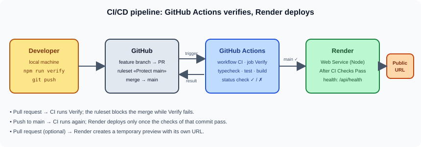

# TP3: CI/CD with GitHub Actions and Render

> Master DevOps & Cloud

Build a real CI/CD pipeline for a small **Express/TypeScript** app: **GitHub Actions** verifies every pull request and every push to `main` (typecheck, tests, build), a **ruleset** blocks merging while the checks fail, and **Render** deploys to production only after CI passes, with optional **pull request previews**.



## Contents

```
tp3-github-actions-render/
├── README.md
├── TP.md                     ← full lab instructions
├── images/                   ← diagrams
└── captures/                 ← your screenshots (deliverables)
```

## Quick start

```bash
git clone https://github.com/wahid007/cicd-lab-starter.git cicd-lab
cd cicd-lab
rm -rf .git && git init -b main
node --version        # must start with v24.
npm ci
npm run dev           # http://localhost:3000/api/health -> {"status":"ok"}
```

Then follow [`TP.md`](TP.md): add the `verify` script, push to your own GitHub repository, deploy on Render, add the GitHub Actions workflow, protect `main`, and run changes through the pipeline.

## Prerequisites

- Node.js 24 and Git on your machine
- A **GitHub** account (public repository, to use rulesets on GitHub Free)
- A **Render** account (Free instance; previews may be billed, check the pricing)

> Unlike TP1 and TP2, this lab uses cloud services (GitHub and Render): an Internet connection is required.

## Deliverables

1. Links to your GitHub repository `cicd-lab` and to your Render production URL
2. Screenshots in `captures/`: `render-first-deploy.png`, `actions-verify-pass.png`, `render-auto-deploy.png`, `ruleset-protect-main.png`, `homepage-updated.png`, `pr-failing-verify.png`, `api-version.png`, `preview-vs-production.png`
3. `REPORT.md`: the pipeline in your own words, comparison with TP2 and difficulties encountered
