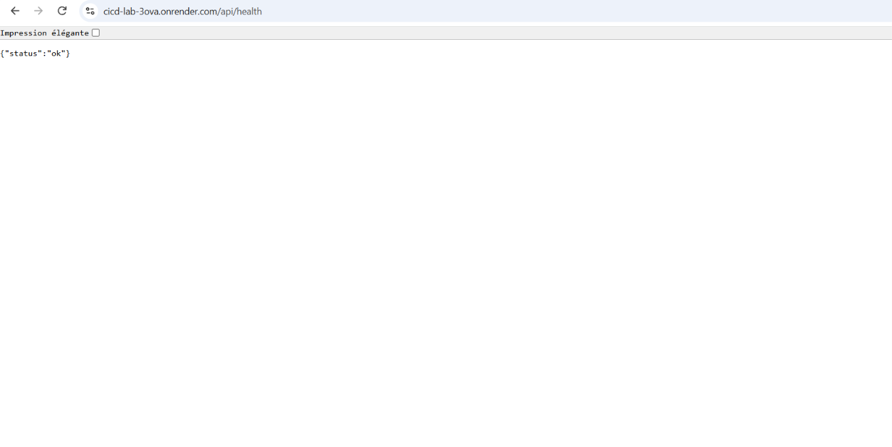
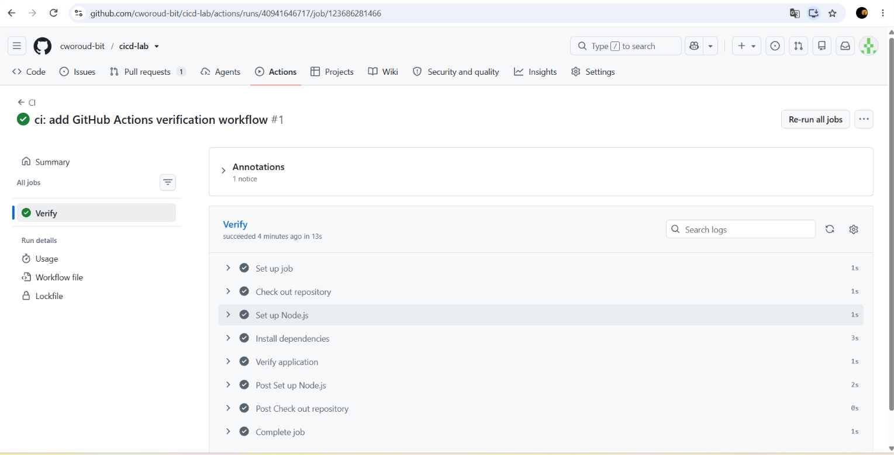
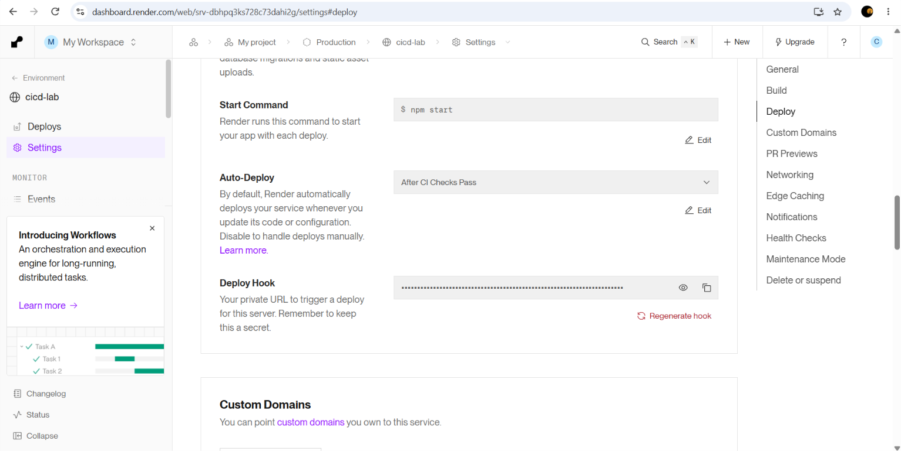
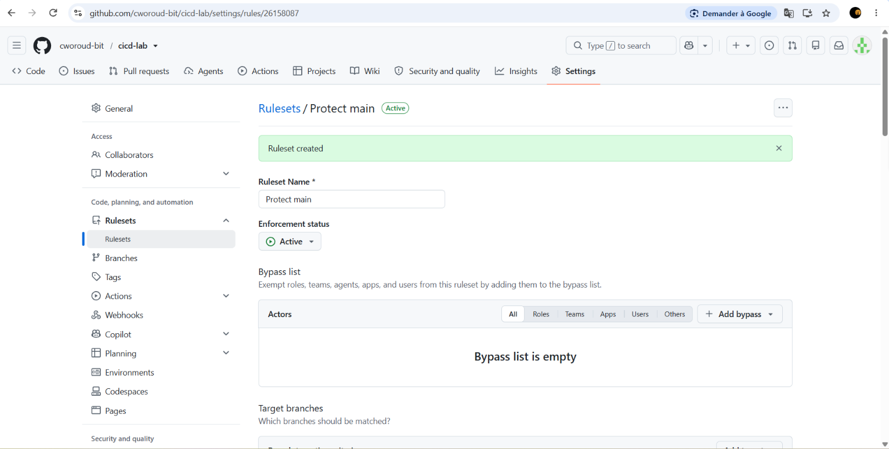
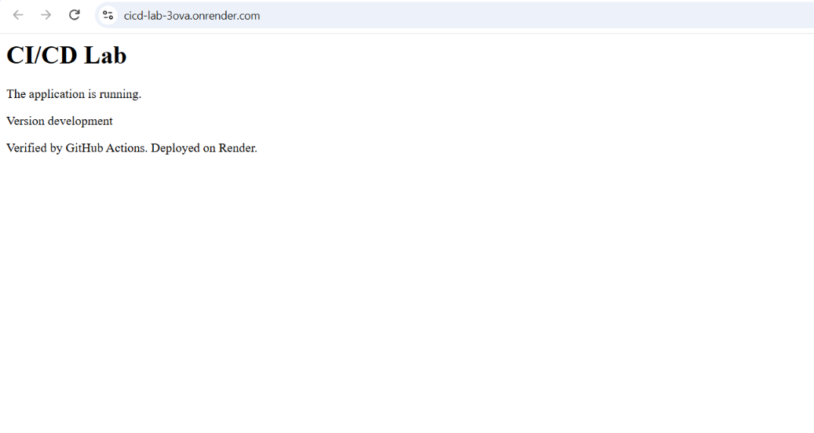
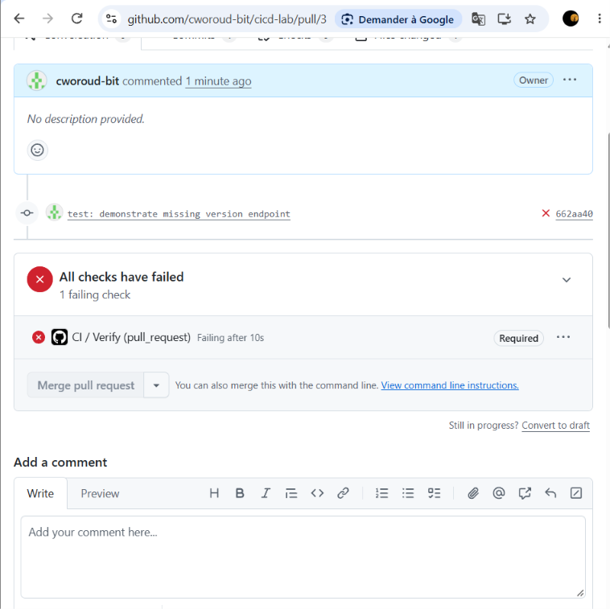
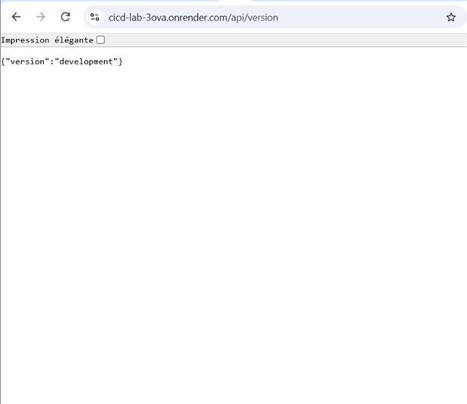
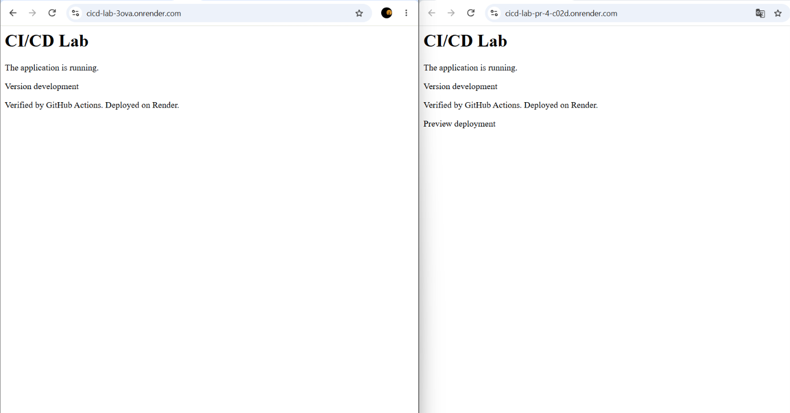

# Rapport TP3 : CI/CD avec GitHub Actions et Render

**Étudiante :** Wrida · **Formation :** Master DevOps & Cloud

## Liens

- Dépôt GitHub : https://github.com/YOUR_USERNAME/cicd-lab
- Production (Render) : https://YOUR_SERVICE.onrender.com

## 1. Le pipeline avec mes mots

L'application est une API Express/TypeScript avec un endpoint `/api/health`. Le pipeline fonctionne ainsi :

1. Je travaille sur une branche (`feature/...`) et je lance `npm run verify` en local (typecheck, tests, build).
2. Je pousse la branche et j'ouvre une pull request vers `main`.
3. **GitHub Actions** exécute le job `Verify` (`npm ci` puis `npm run verify`) sur un runner Ubuntu avec Node 24.
4. Un **ruleset** « Protect main » bloque la fusion tant que `Verify` n'est pas vert : une PR avec un test en échec ne peut pas être mergée.
5. Après la fusion, `Verify` s'exécute de nouveau sur `main`. **Render** est configuré en *After CI Checks Pass* : il ne déploie que si ce contrôle réussit.
6. Pour chaque PR, Render peut créer un **aperçu** (preview) avec sa propre URL, supprimé à la fusion ou à la fermeture de la PR.

Le code n'atteint donc la production qu'après trois barrières : test local, CI sur la PR, CI sur `main`.

## 2. Travail réalisé

| Étape | Résultat |
| --- | --- |
| Application de départ + script `verify` | `npm run verify` réussi en local |
| Premier déploiement Render | Service en ligne, `/api/health` renvoie `{"status":"ok"}` |
| Workflow `ci.yml` | Job `Verify` vert sur la PR et sur `main` |
| Auto-Deploy | Passé de *On Commit* à *After CI Checks Pass* |
| Ruleset « Protect main » | PR obligatoire, check `Verify` requis, bypass vide |
| Changement de page d'accueil | Passé par PR, CI, merge, déploiement automatique |
| Test volontairement en échec | `/api/version` en 404, `Verify` rouge, merge bloqué ; après correction, `Verify` vert et `/api/version` renvoie `{"version":"development"}` |
| Preview deployment | Aperçu avec le nouveau message, production inchangée jusqu'au merge |

## 3. Comparaison avec le TP2 (Coolify + webhook vs GitHub Actions + Render)

| Critère | TP2 : Coolify + Forgejo | TP3 : GitHub Actions + Render |
| --- | --- | --- |
| Hébergement | Auto-hébergé dans ma VM | SaaS dans le cloud |
| Déclencheur | Webhook Forgejo → Coolify à chaque push | Push / PR → GitHub Actions, puis Render |
| Tests avant déploiement | Aucun : le build échoue ou réussit seulement | Oui : `Verify` (typecheck, tests, build) |
| Blocage d'un mauvais code | Seul le build échoué ne remplace pas l'ancienne version | Ruleset : merge impossible sans CI verte |
| Rollback | Revert Git puis redéploiement | Même principe, plus la protection en amont |
| Aperçu par PR | Non (bonus du TP2) | Oui, preview Render |
| Accès / réseau | Nom d'hôte local, fichier `hosts` | URL publique HTTPS |
| Maintenance | Je gère VM, disque, Docker, mises à jour | Gérée par GitHub et Render |
| Coût | Gratuit, mais consomme mes ressources | Offre gratuite, avec limites (démarrage à froid) |

Le TP2 automatise le **déploiement** ; le TP3 ajoute le **contrôle qualité** avant le déploiement. Les deux approches sont complémentaires : on pourrait brancher la CI de GitHub Actions devant un déploiement Coolify.

## 4. Difficultés rencontrées et solutions

| Problème | Cause | Solution |
| --- | --- | --- |
| *À compléter* | *À compléter* | *À compléter* |

## 5. Captures (dossier `captures/`)

| Fichier | Contenu |
| --- | --- |
| `render-first-deploy.png` | Premier déploiement Render réussi et `/api/health` |
| `actions-verify-pass.png` | Job `Verify` réussi dans les logs Actions |
| `render-auto-deploy.png` | Auto-Deploy : After CI Checks Pass |
| `ruleset-protect-main.png` | Ruleset `Protect main` avec le check `Verify` requis |
| `homepage-updated.png` | Page publique avec le nouveau message |
| `pr-failing-verify.png` | `Verify` en échec et merge bloqué |
| `api-version.png` | Réponse de `/api/version` après déploiement |
| `preview-vs-production.png` | URL de preview et de production côte à côte |

