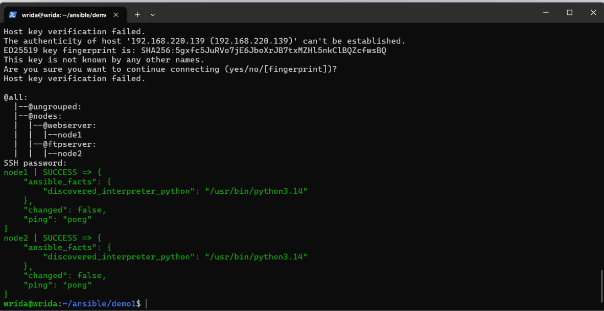
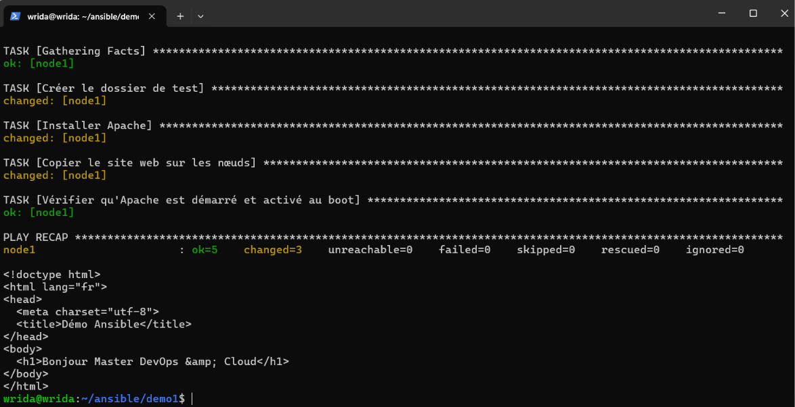
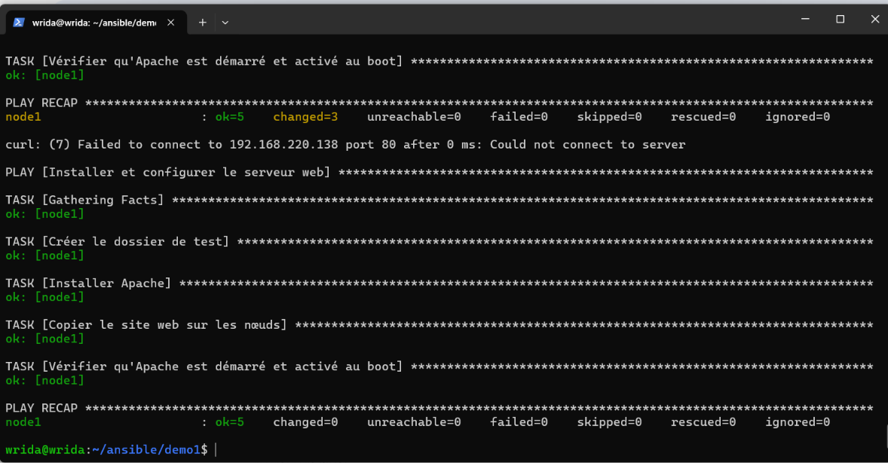
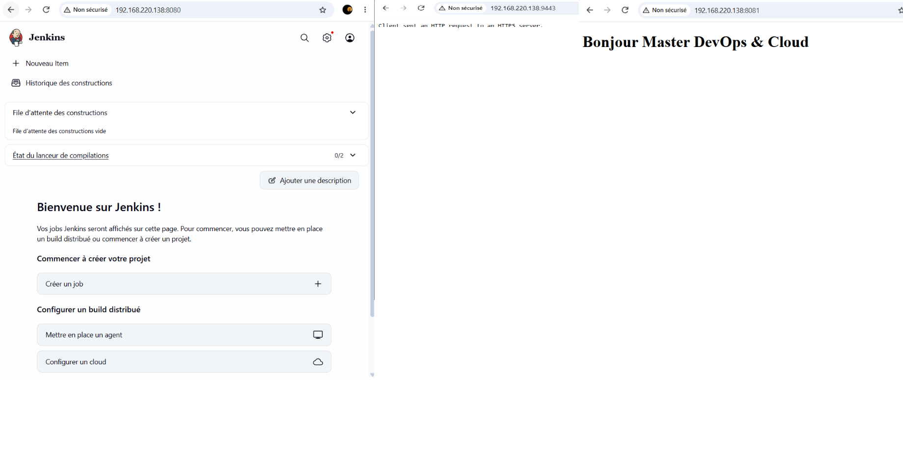
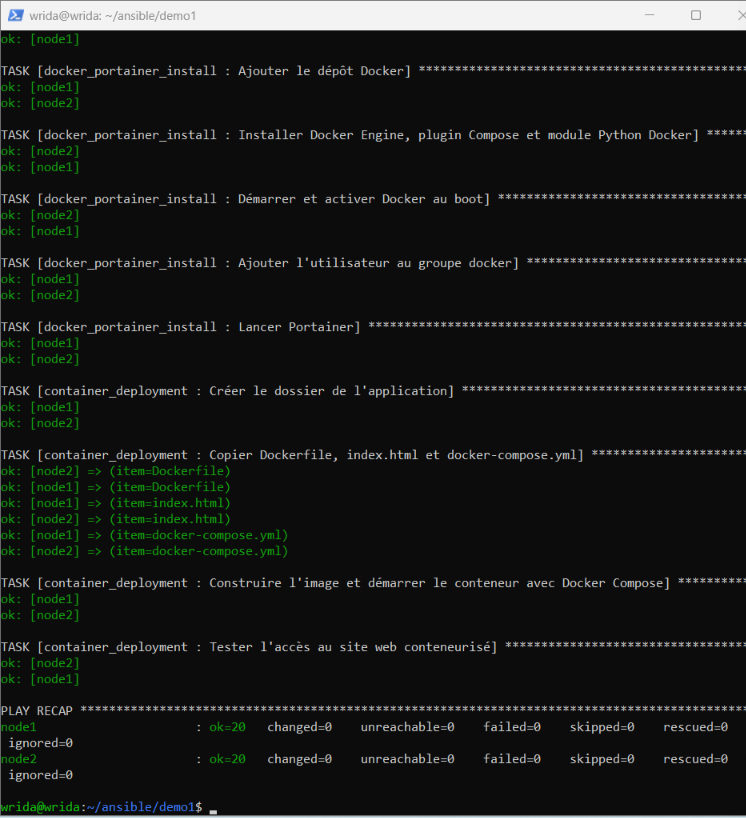

# TP4 : Bases d'Ansible (inventaire, playbooks, clés SSH, rôles)

Environnement : 3 VM Ubuntu Server 26.04 sous VMware.

| Machine | Rôle |
|---|---|
| `wrida` | Nœud de contrôle (Ansible installé) |
| `node1` | Nœud géré, groupe `webserver` |
| `node2` | Nœud géré, groupe `ftpserver` |

Toutes les commandes se lancent depuis le dossier du projet sur le nœud de contrôle (`~/ansible/demo1`), car c'est là que se trouve `ansible.cfg`.

## Contenu du dossier

```
tp4-ansible-bases/
├── ansible.cfg
├── inventory.txt
├── index.html
├── webserver_install.yml      # partie 2 : Apache
├── Dockerfile                 # partie 4 : image nginx + index.html
├── docker-compose.yml         # partie 4 : conteneur web
├── containers_install.yml     # partie 4 : Jenkins, Docker, Portainer, conteneur web
├── site_roles.yml             # partie 5 : même déploiement avec des rôles
├── roles/
│   ├── jenkins_install/
│   ├── docker_portainer_install/
│   └── container_deployment/
└── captures/
```

## Partie 0 : inventaire et test de connexion

`inventory.txt` définit deux groupes (`webserver`, `ftpserver`) regroupés dans le groupe parent `nodes`, avec `ansible_user=wrida`.

```bash
ansible-inventory --graph
ansible all -m ping -k
```

Le module `ping` vérifie la connexion SSH et la présence de Python sur le nœud (ce n'est pas un ping ICMP). Résultat : `SUCCESS` / `pong` sur les deux nœuds.



## Partie 1 : `ansible.cfg`

Le fichier fixe l'inventaire par défaut, l'utilisateur SSH, la désactivation de la vérification des clés d'hôte (lab uniquement) et la découverte silencieuse de l'interpréteur Python. Le test se fait donc sans `-i` :

```bash
ansible all -m ping -k
ansible-config dump --only-changed
```

## Partie 2 : premier playbook (Apache)

`webserver_install.yml` cible le groupe `webserver` : création d'un dossier de test, installation d'Apache, copie de `index.html`, démarrage et activation du service.

```bash
ansible-playbook webserver_install.yml --syntax-check
ansible-playbook webserver_install.yml --check --diff
ansible-playbook webserver_install.yml
curl http://IP_NODE1
```

Premier passage (`changed=3`) puis `curl` qui renvoie la page :



Deuxième passage, `changed=0` : le playbook est **idempotent** (chaque tâche décrit un état souhaité, déjà atteint).



## Partie 3 : authentification par clé SSH

```bash
ssh-keygen -t ed25519 -C "ansible-control"
ssh-copy-id wrida@IP_NODE1
ssh-copy-id wrida@IP_NODE2
ansible-playbook webserver_install.yml
```

Après `ssh-copy-id`, le mot de passe SSH n'est plus demandé : l'option `-k` disparaît.

**Élévation de privilèges (`sudo`).** Sur Ubuntu 26.04, `sudo` est une implémentation différente (`sudo-rs`) dont l'invite de mot de passe n'est pas reconnue par Ansible (erreur « Timeout waiting for privilege escalation prompt » avec `-K`). Solution retenue, valable en lab uniquement : `sudo` sans mot de passe pour l'utilisateur du lab sur chaque nœud.

```bash
echo "wrida ALL=(ALL) NOPASSWD:ALL" | sudo tee /etc/sudoers.d/wrida
sudo chmod 440 /etc/sudoers.d/wrida
```


## Partie 4 : Jenkins, Docker, Portainer et conteneur web

- `Dockerfile` : image `nginx:alpine` contenant `index.html`.
- `docker-compose.yml` : service `web`, port web exposé `8081:80`. L'image est construite directement sur chaque nœud par Docker Compose (alternative à Docker Hub prévue par l'énoncé).
- `containers_install.yml` : installe Java 21 + Jenkins (dépôt LTS officiel), Docker (dépôt officiel) + Portainer, puis déploie le conteneur web avec Compose et teste qu'il répond (HTTP 200).

```bash
ansible-playbook containers_install.yml
```

| Service | URL |
|---|---|
| Jenkins | `http://IP:8080` |
| Portainer | `https://IP:9443` |
| Site web (conteneur) | `http://IP:8081` |



## Partie 5 : le même déploiement avec des rôles

Les tâches sont réorganisées en trois rôles réutilisables (`roles/NOM/tasks/main.yml`, variables dans `defaults/main.yml`), appelés par `site_roles.yml` :

1. `jenkins_install`
2. `docker_portainer_install`
3. `container_deployment`

```bash
ansible-playbook site_roles.yml
ansible-playbook site_roles.yml      # 2e passage : changed=0
```


