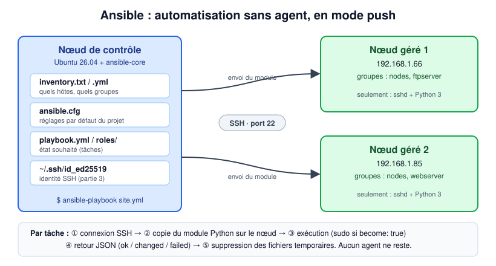
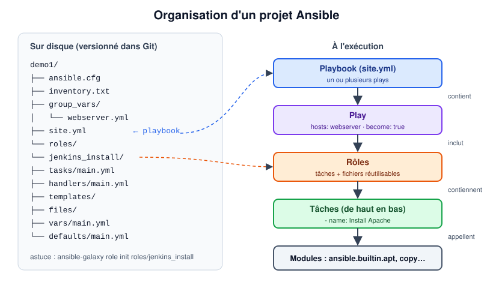
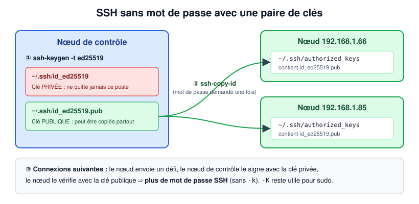

# TP4 : Bases d'Ansible (inventaire, playbooks, clés SSH, rôles)

> Master DevOps & Cloud

Ansible est un outil open source d'automatisation informatique en ligne de commande, écrit en Python. Il permet de configurer des systèmes, de déployer des logiciels et d'orchestrer des workflows avancés : déploiement d'applications, mises à jour système, etc.

Ses points forts sont la **simplicité** et la **facilité d'utilisation**, avec un accent sur la sécurité et la fiabilité (très peu de composants). Il est **sans agent** (*agentless*) : il utilise **OpenSSH** comme transport (d'autres transports et un mode *pull* existent), donc les nœuds gérés n'ont besoin que d'un serveur SSH et de Python. Son langage YAML, lisible, permet de démarrer rapidement sans longue formation.

---

## 1. Objectifs pédagogiques

À l'issue du TP, vous serez capable de :

- décrire l'architecture d'Ansible (nœud de contrôle, nœuds gérés, inventaire, modules) ;
- écrire un **inventaire**, un fichier `ansible.cfg` et un premier **playbook idempotent** ;
- passer d'une authentification SSH par mot de passe à une authentification **par clé** ;
- automatiser l'installation de Jenkins, Docker, Portainer et d'un conteneur applicatif ;
- réorganiser un playbook en **rôles**.

## 2. Introduction



> Les images de `images/` sont des **schémas** explicatifs, pas des captures d'écran.

| Terme                | Signification                                                                                                     |
| -------------------- | ----------------------------------------------------------------------------------------------------------------- |
| **Nœud de contrôle** | La machine où Ansible est installé et depuis laquelle on lance `ansible` / `ansible-playbook`.                    |
| **Nœud géré**        | Un hôte cible configuré par Ansible. Il n'a besoin que de `sshd` et de Python 3 ; aucun agent n'est installé.     |
| **Inventaire**       | La liste des nœuds gérés, organisés en **groupes**.                                                               |
| **Module**           | Une unité de travail (`apt`, `copy`, `file`, `service`…) qu'Ansible copie sur le nœud et y exécute.              |
| **Tâche**            | Un appel à un module, avec un `name` lisible.                                                                     |
| **Playbook**         | Un fichier YAML contenant un ou plusieurs *plays*. Chaque play associe un groupe d'hôtes à une liste de tâches/rôles. |
| **Rôle**             | Un ensemble réutilisable et autonome de tâches, handlers, fichiers, templates et variables.                       |

### 2.1 Installer Ansible

Ansible s'installe **uniquement sur le nœud de contrôle** (une machine Linux). Sur Ubuntu :

```shell
sudo apt update
sudo apt install -y ansible sshpass      # sshpass est nécessaire pour le SSH par mot de passe (-k)
ansible --version
```

> Alternative (dernière version, isolée du Python système) : `sudo apt install -y pipx && pipx install --include-deps ansible`

### 2.2 Structure du code Ansible

Avec Ansible, le travail s'écrit dans des fichiers YAML (`.yml`) contenant une suite de tâches, **exécutées dans l'ordre, de haut en bas**. Ansible fournit des centaines de modules Python prêts à l'emploi qui encapsulent des fonctions du système. Utilisez leur nom complet (FQCN, *fully qualified collection name*), par exemple `ansible.builtin.apt`.

La plupart des modules sont **idempotents** : ils décrivent un *état souhaité* (`state: present`) plutôt qu'une action. Exécuter deux fois le même playbook est donc sans risque, et le second passage doit afficher `changed=0`.

### 2.3 Playbooks et rôles

Un playbook peut être écrit comme un document monolithique contenant une suite de tâches nommées.
Pour des projets plus importants, on regroupe les tâches de bas niveau dans des **rôles**, puis on appelle ces rôles depuis des playbooks de plus haut niveau (en ajoutant parfois quelques tâches au niveau du playbook).
Cette séparation des responsabilités rend les rôles clairs, réutilisables et partageables (par exemple sur [Ansible Galaxy](https://galaxy.ansible.com)).

### 2.4 Organisation d'un projet Ansible

Un projet Ansible s'organise en arborescence. Cette hiérarchie se versionne facilement dans Git et se prête à une approche *GitOps* de l'infrastructure as code.
Elle contient les fichiers d'inventaire, les fichiers de variables (`group_vars/`, `host_vars/`), les rôles, les fichiers utilitaires et les playbooks principaux.



## 3. Partie 0 : Préparer l'environnement de test

- [ ] Créer 3 VM **Ubuntu Server 26.04** : 1 **nœud de contrôle** Ansible et 2 **nœuds** gérés. Elles doivent pouvoir communiquer entre elles (même commutateur virtuel / pont).
- [ ] Utiliser le même compte utilisateur (par ex. `devops`) avec les droits `sudo` sur chaque VM, et vérifier que SSH tourne sur les nœuds (`sudo systemctl status ssh`).
- [ ] Sur le nœud de contrôle, créer un dossier de projet `~/ansible/demo1`.
- [ ] Créer le fichier d'inventaire, qui liste les hôtes contrôlés par Ansible. Au choix `inventory.txt` (format INI) ou `inventory.yml` (format YAML) :

`inventory.txt`

```ini
[webserver]
192.168.1.85

[ftpserver]
192.168.1.66

# "nodes" est un groupe parent qui contient les deux groupes ci-dessus
[nodes:children]
webserver
ftpserver

[nodes:vars]
ansible_user=devops
```

ou `inventory.yml`

```yaml
all:
  children:
    nodes:
      vars:
        ansible_user: devops
      children:
        webserver:
          hosts:
            192.168.1.85:
        ftpserver:
          hosts:
            192.168.1.66:
```

> Remplacez les adresses IP et `devops` par vos propres valeurs (`ip -br a` sur chaque nœud). Groupes prédéfinis : `all` (tous les hôtes) et `ungrouped`.

- [ ] Vérifier ce qu'Ansible a compris de l'inventaire :

  ```shell
  ansible-inventory -i inventory.txt --graph
  ```

- [ ] Tester la connexion du nœud de contrôle vers les hôtes avec le module `ping`. Ce n'est pas un ping ICMP : il vérifie la connexion SSH et la présence d'un Python utilisable sur le nœud.

  ```shell
  ansible all -i inventory.txt -m ping -k
  # -k / --ask-pass        : demande le mot de passe SSH (nécessite sshpass)
  # -K / --ask-become-pass : demande le mot de passe sudo (nécessaire avec become: true)
  ```

  Résultat attendu pour chaque nœud : `"ping": "pong"` avec `SUCCESS`.

> En cas d'erreur *host key verification failed*, connectez-vous une fois à la main (`ssh devops@192.168.1.85`) et acceptez l'empreinte, ou réglez `host_key_checking` (voir partie 1).

## 4. Partie 1 : Ajouter un fichier ansible.cfg

- [ ] Dans `demo1`, ajouter `ansible.cfg` pour définir la configuration par défaut du projet. Ansible lit `./ansible.cfg` (dossier courant) avant `~/.ansible.cfg` et `/etc/ansible/ansible.cfg`.

  ```ini
  [defaults]
  inventory = ./inventory.txt
  remote_user = devops          ; utilisateur SSH si ansible_user n'est pas défini
  host_key_checking = False     ; lab uniquement : ne pas demander les clés d'hôte SSH inconnues
  deprecation_warnings = False
  ```

- [ ] Tester la connexion avec le module `ping` **sans** passer `-i inventory.txt` :

  ```shell
  ansible all -m ping -k
  ansible-config dump --only-changed     # affiche les réglages venant de ansible.cfg
  ```

## 5. Partie 2 : Créer un premier playbook

- [ ] Dans `demo1`, créer le playbook `webserver_install.yml` :

```yaml
---
- name: Installer et configurer le serveur web
  hosts: webserver          # groupe de l'inventaire ("all" pour cibler tous les hôtes)
  become: true              # exécuter les tâches avec sudo
  gather_facts: true

  tasks:
    - name: Créer le dossier de test
      ansible.builtin.file:
        path: "/home/{{ ansible_user }}/test"
        state: directory
        owner: "{{ ansible_user }}"
        mode: '0755'

    - name: Installer Apache
      ansible.builtin.apt:
        name: apache2
        state: present
        update_cache: true

    - name: Copier le site web sur les nœuds
      ansible.builtin.copy:
        src: index.html
        dest: /var/www/html/index.html
        owner: www-data
        group: www-data
        mode: '0644'

    - name: Vérifier qu'Apache est démarré et activé au boot
      ansible.builtin.service:
        name: apache2
        state: started
        enabled: true
```

- [ ] Créer le fichier `index.html` à côté du playbook :

  ```html
  <!doctype html>
  <html lang="fr">
  <head>
    <meta charset="utf-8">
    <title>Démo Ansible</title>
  </head>
  <body>
    <h1>Bonjour Master DevOps & Cloud</h1>
  </body>
  </html>
  ```

- [ ] Vérifier la syntaxe, faire un essai à blanc (*dry run*), puis exécuter le playbook :

  ```shell
  ansible-playbook webserver_install.yml --syntax-check
  ansible-playbook webserver_install.yml -k -K --check --diff   # essai à blanc : montre ce qui changerait
  ansible-playbook webserver_install.yml -k -K
  # -k : mot de passe SSH, -K : mot de passe sudo (become)
  ```

- [ ] Vérifier le résultat depuis le nœud de contrôle :

  ```shell
  curl http://192.168.1.85
  ```

- [ ] Exécuter le playbook une **deuxième fois**. Le `PLAY RECAP` doit afficher `changed=0`, car chaque tâche est déjà dans l'état souhaité (idempotence).

## 6. Partie 3 : Utiliser une paire de clés SSH privée/publique



- [ ] Pour se connecter aux hôtes avec une paire de clés plutôt qu'un mot de passe, générer la paire sur le **nœud de contrôle** (Entrée pour accepter le chemin par défaut) :

  ```shell
  ssh-keygen -t ed25519 -C "ansible-control"
  ```

- [ ] Copier la clé publique sur chaque nœud (le mot de passe est demandé une dernière fois) :

  ```shell
  ssh-copy-id devops@192.168.1.66
  ssh-copy-id devops@192.168.1.85
  ```

- [ ] Relancer le playbook. Le mot de passe SSH n'est plus demandé, donc `-k` disparaît. `-K` reste nécessaire pour `sudo` :

  ```shell
  ansible-playbook webserver_install.yml -K
  ```

> Optionnel : pour se passer aussi de `-K`, autoriser `sudo` sans mot de passe pour l'utilisateur du lab sur chaque nœud (`echo "devops ALL=(ALL) NOPASSWD:ALL" | sudo tee /etc/sudoers.d/devops`). À faire **uniquement** dans un lab.

## 7. Partie 4 : Playbook d'installation de conteneurs Docker

- [ ] Créer une image Docker contenant votre site web (`index.html`) : préparer le `Dockerfile`.
- [ ] Pousser l'image sur votre compte **Docker Hub** (cette image sera réutilisée au [TP5](../tp5-vagrant/TP.md)).
- [ ] Créer un playbook Ansible qui :
  - installe **Jenkins** ;
  - installe **Docker** ;
  - installe **Portainer** ;
  - crée un conteneur à partir de l'image Docker créée ci-dessus, à l'aide d'un fichier `docker-compose.yml` (n'oubliez pas d'exposer le port web).
- [ ] Tester l'accès aux conteneurs créés.

> **Exception à la règle « 100 % local »** : cette partie nécessite un compte Docker Hub (gratuit). À défaut, construisez l'image directement sur chaque nœud avec `docker build`.

## 8. Partie 5 : Le même playbook avec des `roles`

Réorganiser le playbook pour utiliser des **rôles** au lieu de **tâches**. Le playbook contiendra ces rôles :

- `jenkins_install`
- `docker_portainer_install`
- `container_deployment`

(**astuce** : utilisez l'outil en ligne de commande `ansible-galaxy` pour créer les rôles, ou créez directement `roles/NOM_DU_ROLE/tasks/main.yml`)

```shell
mkdir -p roles
ansible-galaxy role init roles/jenkins_install
```

`ansible-galaxy role init` génère ce squelette. Seul `tasks/main.yml` est obligatoire ; vous pouvez supprimer les dossiers inutilisés :

```text
roles/jenkins_install/
├── defaults/main.yml    # variables par défaut (priorité la plus basse)
├── files/               # fichiers statiques pour le module copy
├── handlers/main.yml    # handlers (ex. redémarrer un service), déclenchés par "notify"
├── meta/main.yml        # métadonnées du rôle et dépendances
├── tasks/main.yml       # liste des tâches du rôle (point d'entrée)
├── templates/           # templates Jinja2 (.j2) pour le module template
├── tests/
└── vars/main.yml        # variables du rôle (priorité haute)
```

- [ ] Relancer le playbook à base de rôles deux fois : le second passage doit afficher `changed=0`.

## 9. Livrables

Captures à déposer dans [`captures/`](captures/) :

| Fichier                 | Contenu attendu                                                         |
| ----------------------- | ----------------------------------------------------------------------- |
| `ping-pong.png`         | `ansible all -m ping` avec `SUCCESS` / `pong` sur les 2 nœuds           |
| `playbook-run.png`      | Premier passage de `webserver_install.yml` + `curl` sur le nœud web     |
| `idempotence.png`       | Deuxième passage avec `changed=0` dans le `PLAY RECAP`                  |
| `ssh-keys.png`          | Exécution sans `-k` après `ssh-copy-id`                                 |
| `containers.png`        | Jenkins, Portainer et le conteneur web accessibles depuis le navigateur |
| `roles-run.png`         | Exécution du playbook à base de rôles                                   |

Ainsi que votre dossier de projet (`demo1/` : inventaire, `ansible.cfg`, playbooks, `roles/`, `Dockerfile`, `docker-compose.yml`).
