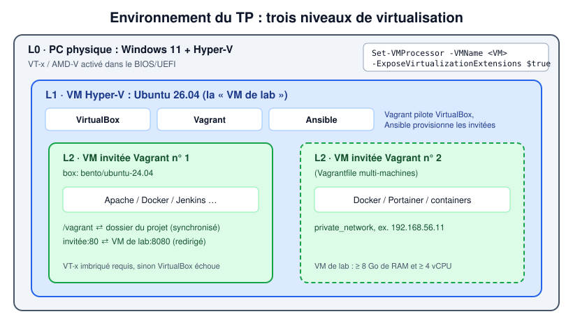
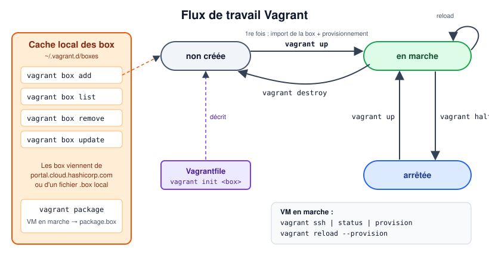
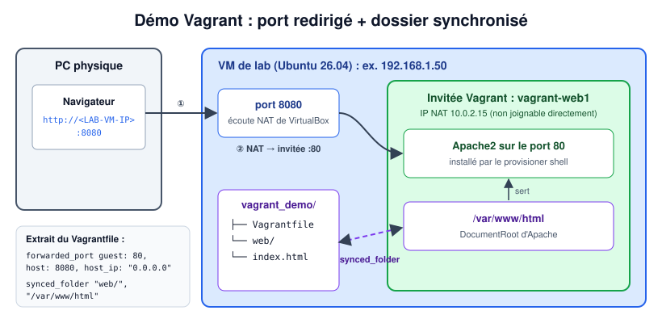
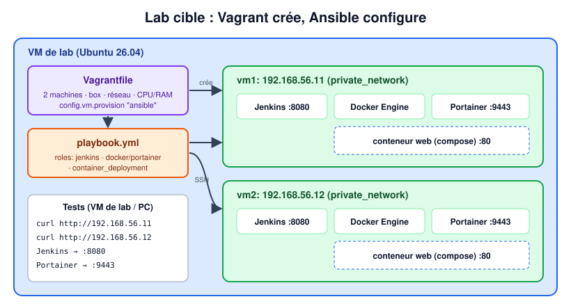

# TP5 : Environnements de lab reproductibles avec Vagrant

> Master DevOps & Cloud

Vagrant (HashiCorp) crée et configure des environnements de développement légers, reproductibles et portables. On décrit la ou les machines virtuelles dans un seul fichier texte, le **`Vagrantfile`**, et Vagrant demande à un *provider* (VirtualBox, Hyper-V, VMware, libvirt, Docker…) de les construire. Il peut ensuite lancer un *provisioner* (shell, Ansible…) pour les configurer.

---

## 1. Objectifs pédagogiques

À l'issue du TP, vous serez capable de :

- préparer une VM de lab avec la **virtualisation imbriquée** (Hyper-V → VirtualBox) ;
- utiliser les commandes essentielles de Vagrant (box, cycle de vie d'une machine) ;
- écrire un `Vagrantfile` avec provisionnement, dossier synchronisé et redirection de port ;
- combiner **Vagrant** (création des VM) et **Ansible** (configuration) pour monter un lab complet.

## 2. Introduction

Dans ce TP, vous créez votre premier environnement de développement avec Vagrant. Cette prise en main présente Vagrant, ses prérequis et ses commandes les plus importantes.

| Terme           | Signification                                                                                         |
| --------------- | ----------------------------------------------------------------------------------------------------- |
| **Box**         | Une image de base d'un OS (par ex. `bento/ubuntu-24.04`), téléchargée une fois puis mise en cache.     |
| **Provider**    | L'hyperviseur qui exécute la VM. Par défaut : `virtualbox`.                                           |
| **Provisioner** | Ce qui configure la VM après le démarrage : script `shell` en ligne, `ansible`, `file`, `docker`…     |
| **Vagrantfile** | Fichier Ruby qui décrit les machines, leur réseau, les dossiers synchronisés, les ressources et les provisioners. |

> Les images de `images/` sont des **schémas** explicatifs, pas des captures d'écran.

## 3. Environnement du TP



- [ ] Utiliser une **VM Ubuntu 26.04** (la *VM de lab*) sur laquelle on installe VirtualBox, Vagrant et Ansible. Lui donner au moins 4 vCPU, 8 Go de RAM et 60 Go de disque.

- [ ] VirtualBox tournant **à l'intérieur** d'une VM Hyper-V, il faut activer la **virtualisation imbriquée** pour cette VM.

- [ ] Dans Hyper-V, **arrêter la VM de lab**, puis lancer cette commande dans un **PowerShell administrateur sur l'hôte Windows** :

  ```powershell
  Set-VMProcessor -VMName <NomDeLaVM> -ExposeVirtualizationExtensions $true
  # vérification :
  Get-VMProcessor -VMName <NomDeLaVM> | Select-Object ExposeVirtualizationExtensions
  ```

- [ ] Démarrer la VM de lab et vérifier que les extensions de virtualisation du CPU sont visibles. Le résultat doit être **supérieur à 0** :

  ```shell
  grep -Ec '(vmx|svm)' /proc/cpuinfo
  ```

- [ ] Installer VirtualBox, Vagrant (depuis le dépôt officiel HashiCorp) et Ansible sur la VM de lab :

  ```shell
  # VirtualBox + Ansible
  sudo apt update
  sudo apt install -y virtualbox ansible

  # Vagrant (dépôt APT HashiCorp)
  wget -O- https://apt.releases.hashicorp.com/gpg | sudo gpg --dearmor -o /usr/share/keyrings/hashicorp-archive-keyring.gpg
  echo "deb [arch=$(dpkg --print-architecture) signed-by=/usr/share/keyrings/hashicorp-archive-keyring.gpg] https://apt.releases.hashicorp.com $(lsb_release -cs) main" \
    | sudo tee /etc/apt/sources.list.d/hashicorp.list
  sudo apt update && sudo apt install -y vagrant

  # vérification
  vagrant --version
  VBoxManage --version
  ```

> Si le dépôt HashiCorp ne publie pas encore de paquets pour votre version d'Ubuntu, remplacez `$(lsb_release -cs)` par le nom de code de la LTS précédente (`noble`).

## 4. Commandes Vagrant utiles



### Initialiser Vagrant

```shell
vagrant init bento/ubuntu-24.04
```

Crée un fichier de configuration `Vagrantfile` dans le dossier courant, avec la box `bento/ubuntu-24.04`. Chaque projet doit avoir son propre dossier.

Pour un test rapide, on peut utiliser une petite box comme Alpine :

```shell
vagrant init generic/alpine319
```

> Les box se trouvent sur le [registre Vagrant de HashiCorp](https://portal.cloud.hashicorp.com/vagrant/discover). Préférez des box maintenues comme `bento/*` (de Chef) et vérifiez que la box prend en charge votre provider (`virtualbox`, `hyperv`…).

### Démarrer l'environnement et choisir le provider

```shell
vagrant up                        # provider par défaut : virtualbox
vagrant up --provider=virtualbox  # identique, explicite
```

Le provider par défaut est **virtualbox**, celui utilisé dans ce TP (Vagrant tourne dans la VM de lab Ubuntu). `--provider=hyperv` ne sert que si Vagrant tourne **directement sous Windows** avec Hyper-V, depuis un shell administrateur.

### Afficher l'état de la ou des machines

```shell
vagrant status          # machines du projet courant
vagrant global-status   # toutes les machines Vagrant de cet hôte
```

### Se connecter à la machine

```shell
vagrant ssh
```

### Relancer les provisioners / redémarrer avec la nouvelle configuration

```shell
vagrant provision            # relance les provisioners sur une VM en marche
vagrant reload --provision   # redémarre la VM, applique les changements du Vagrantfile, puis provisionne
```

### Arrêter la machine (en conservant son disque)

```shell
vagrant halt
```

### Créer une box à partir de la machine en marche

```shell
vagrant package --output package.box
```

### Ajouter une box à votre liste

```shell
vagrant box add --name my-box ./package.box
```

### Détruire l'environnement

```shell
vagrant destroy       # demande une confirmation
vagrant destroy -f    # sans confirmation
```

### Installer une box

```shell
vagrant box add bento/ubuntu-24.04 --provider virtualbox
# vagrant box add bento/ubuntu-22.04
# vagrant box add generic/alpine319
```

### Supprimer une box

```shell
vagrant box remove NOM_DE_LA_BOX
```

### Lister les box

```shell
vagrant box list
```

---

## 5. Démo Vagrant

- [ ] Créer un dossier `vagrant_demo` avec un sous-dossier `web/` et une page de test. Le dossier synchronisé ci-dessous doit exister avant `vagrant up` :

  ```shell
  mkdir -p ~/vagrant_demo/web && cd ~/vagrant_demo
  echo "<h1>Bonjour depuis Vagrant</h1>" > web/index.html
  ```

- [ ] Dans `vagrant_demo`, créer le `Vagrantfile` suivant :

```ruby
# vi: ft=ruby:ts=2:ai:sw=2
$script = <<-SCRIPT
echo "Provisionnement de l'OS"
sudo apt-get update
sudo apt-get install -y apache2
SCRIPT

Vagrant.configure("2") do |config|
  config.vm.box = "bento/ubuntu-24.04"
  config.vm.provision "shell", inline: $script
  config.vm.synced_folder "web/", "/var/www/html"
  # host_ip "0.0.0.0" rend le port 8080 joignable depuis l'extérieur de la VM de lab (défaut : toutes les interfaces)
  config.vm.network "forwarded_port", guest: 80, host: 8080, host_ip: "0.0.0.0"

  config.vm.hostname = "vagrant-web1"
  # Optionnel : donner à la VM une IP joignable depuis la VM de lab
  # config.vm.network "private_network", ip: "192.168.56.10"
  config.vm.provider "virtualbox" do |vb|
    vb.name = "vagrant-web1"
    vb.memory = 1024
    vb.cpus = 2
  end

  ##################################################
  # Provisionner avec Ansible au lieu du shell
  ##################################################
  # config.vm.provision "ansible" do |a|
  #   # a.verbose = "v"
  #   a.playbook = "playbook.yml"
  # end
end
```

Ce `Vagrantfile` crée automatiquement une machine virtuelle avec le provider VirtualBox :

- La VM est provisionnée par un script shell en ligne qui installe le serveur web Apache. Le provisionnement ne s'exécute qu'au **premier** `vagrant up` ; utilisez `vagrant provision` pour le relancer.
- Le dossier local `web/` est **synchronisé** avec `/var/www/html` (le DocumentRoot d'Apache) : modifier `web/index.html` sur la VM de lab change immédiatement le site.
- Le port **80** de l'invitée est **redirigé** vers le port **8080** de la VM de lab.
- La VM a pour nom d'hôte **vagrant-web1**, 1 Go de RAM et 2 CPU.



- [ ] Récupérer la box `bento/ubuntu-24.04` :

```shell
vagrant box add bento/ubuntu-24.04 --provider virtualbox
```

- [ ] Puis lancer :

```shell
vagrant up
```

Cette commande crée et provisionne l'environnement virtuel.

- [ ] Tester :
  - depuis la VM de lab : `curl http://localhost:8080`
  - depuis votre machine physique, ouvrir `http://IP-VM-LAB:8080`, où `IP-VM-LAB` est l'adresse IP de la VM Ubuntu où Vagrant est installé (`ip -br a`), **et non** celle de l'invitée Vagrant.

- [ ] Détruire la VM :

```shell
vagrant destroy
```

---

## 6. Lab : créer un environnement de lab virtuel



- [ ] Avec **Vagrant** et **Ansible**, créer un _lab virtuel_ de 2 VM (`Vagrantfile` multi-machines, réseau `private_network`) sur lesquelles sont installés :
  - Jenkins ;
  - Docker ;
  - Portainer ;
  - un conteneur issu de **l'image Docker de votre application web** créée au [TP4, partie 4](../tp4-ansible-bases/TP.md#7-partie-4--playbook-dinstallation-de-conteneurs-docker), lancé à l'aide d'un fichier `docker-compose.yml` (n'oubliez pas d'exposer le port web).
- [ ] Réutiliser les **rôles** du TP4 (partie 5) via le provisioner `ansible` du `Vagrantfile`.
- [ ] Tester l'accès aux conteneurs créés.

## 7. Livrables

Captures à déposer dans [`captures/`](captures/) :

| Fichier             | Contenu attendu                                                         |
| ------------------- | ----------------------------------------------------------------------- |
| `nested-virt.png`   | `grep -Ec '(vmx\|svm)' /proc/cpuinfo` > 0 et `vagrant --version`         |
| `vagrant-demo.png`  | La page de `vagrant_demo` ouverte depuis le PC physique (port 8080)     |
| `vagrant-status.png`| `vagrant status` montrant les 2 VM du lab en `running`                  |
| `lab-services.png`  | Jenkins, Portainer et le conteneur web accessibles sur les 2 VM         |

Ainsi que le dossier du lab (`Vagrantfile`, playbook, `roles/`, `docker-compose.yml`).
