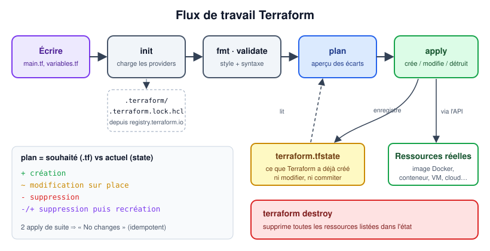

# TP6 : Terraform et intégration Vagrant + Ansible

> Master DevOps & Cloud

Décrire une infrastructure de manière déclarative avec **Terraform** (provider Docker local puis distant via SSH), puis enchaîner **Vagrant → Ansible → Terraform** pour déployer un CV One Page sur deux VM.



## Contenu du dossier

```
.
├── README.md      ← cette page
├── TP.md          ← énoncé complet du TP
├── images/        ← schémas de l'énoncé
└── captures/      ← vos captures d'écran (livrables)
```

## Démarrage rapide

```bash
terraform version
mkdir -p ~/terraform/docker-nginx && cd ~/terraform/docker-nginx
# écrire main.tf (section 5 du TP), puis :
terraform init
terraform plan
terraform apply
curl http://localhost:8001
terraform destroy
```

Puis passez au **TP d'intégration** (section 6) dans [`TP.md`](TP.md).

## Prérequis

- VM de lab Ubuntu Server 26.04 avec VirtualBox, Vagrant, Ansible ([TP5](../tp5-vagrant/)), Docker et Terraform
- Authentification SSH par clé ([TP4](../tp4-ansible-bases/), partie 3)
- Un compte Docker Hub pour l'image du CV

## Livrables

1. Les fichiers du projet (`*.tf`, `.terraform.lock.hcl`, `Vagrantfile`, playbook, `Dockerfile`), **sans** `terraform.tfstate`
2. Captures dans `captures/` :
   - `terraform-plan.png`, `terraform-apply.png`, `terraform-remote.png`, `integration-cv.png`, `reverse-proxy.png` (défi)
