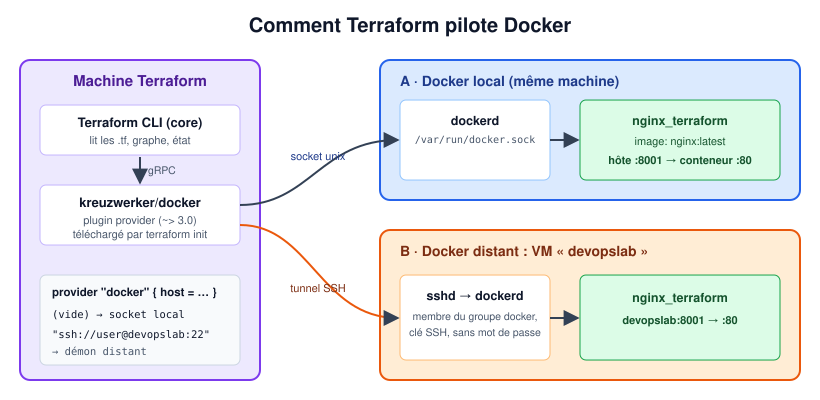
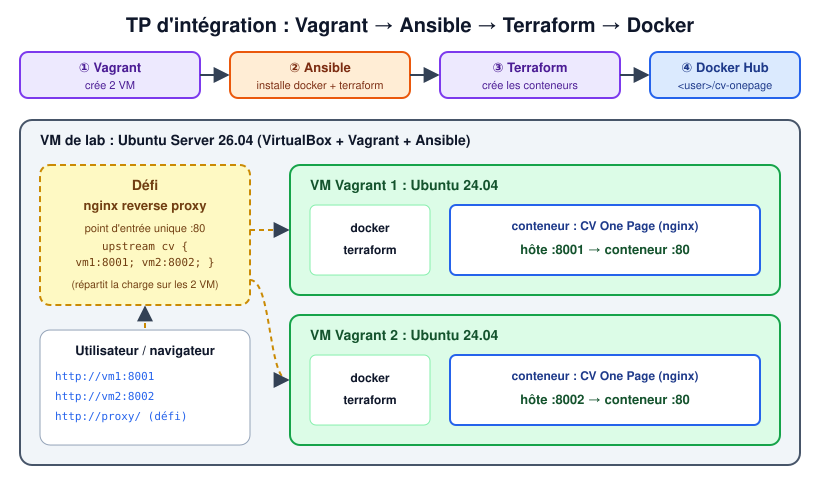

# TP6 : Infrastructure as Code avec Terraform (et intégration Vagrant + Ansible)

> Master DevOps & Cloud

**Terraform** ([site officiel](https://www.terraform.io/)) est un outil d'*Infrastructure as Code* (IaC) édité par HashiCorp. Il automatise la construction des ressources d'une infrastructure : réseaux, machines virtuelles, groupes de sécurité, bases de données…

On décrit l'infrastructure de manière **déclarative** en HCL (*HashiCorp Configuration Language*), dans des fichiers `.tf` (le JSON, `.tf.json`, est aussi possible). Terraform compare cet *état souhaité* à l'*état actuel* enregistré dans son fichier d'état (*state*) et calcule les actions nécessaires pour passer de l'un à l'autre.

Grâce aux **providers** (plugins), Terraform pilote les principales plateformes cloud et d'infrastructure : Amazon Web Services, IBM Cloud, Google Cloud Platform, Linode, Microsoft Azure, Oracle Cloud Infrastructure, OVHcloud, VMware vSphere, OpenStack, mais aussi Docker, Kubernetes, GitHub, etc.

> Terraform est sous licence BSL (*Business Source License*) depuis la v1.6. [OpenTofu](https://opentofu.org/) est un fork open source compatible (`tofu` au lieu de `terraform`). Tout ce TP fonctionne avec les deux.

---

## 1. Objectifs pédagogiques

À l'issue du TP, vous serez capable de :

- installer Terraform et utiliser son cycle `init` → `plan` → `apply` → `destroy` ;
- piloter Docker (local puis distant via SSH) avec le provider `kreuzwerker/docker` ;
- paramétrer une configuration avec des **variables** ;
- enchaîner **Vagrant** ([TP5](../tp5-vagrant/TP.md)), **Ansible** ([TP4](../tp4-ansible-bases/TP.md)) et **Terraform** dans un même lab.

> Les images de `images/` sont des **schémas** explicatifs, pas des captures d'écran.

## 2. Environnement du TP

- [ ] Utiliser une **VM Ubuntu Server 26.04** sur laquelle on installe VirtualBox, Vagrant, Ansible, Docker et Terraform.

- [ ] Activer la virtualisation imbriquée pour cette VM (voir [TP5, section 3](../tp5-vagrant/TP.md#3-environnement-du-tp)).

- [ ] Pour l'exemple Docker, Docker Engine doit être installé et votre utilisateur doit pouvoir l'utiliser :

  ```shell
  sudo apt install -y docker.io
  sudo usermod -aG docker $USER   # puis se déconnecter et se reconnecter
  docker ps
  ```

## 3. Installer Terraform

```shell
sudo apt update && sudo apt install -y gnupg software-properties-common wget
wget -O- https://apt.releases.hashicorp.com/gpg | sudo gpg --dearmor -o /usr/share/keyrings/hashicorp-archive-keyring.gpg
echo "deb [arch=$(dpkg --print-architecture) signed-by=/usr/share/keyrings/hashicorp-archive-keyring.gpg] https://apt.releases.hashicorp.com $(lsb_release -cs) main" \
  | sudo tee /etc/apt/sources.list.d/hashicorp.list
sudo apt update
sudo apt install -y terraform
```

> Si le dépôt HashiCorp est déjà configuré (TP5), seules les deux dernières commandes sont nécessaires.

## 4. Vérifier l'installation

```shell
terraform version
terraform -install-autocomplete   # optionnel : auto-complétion dans le shell
```

## 5. Exemple simple avec Docker

Créer un conteneur nginx sur Docker avec Terraform. Chaque projet Terraform vit dans son propre dossier :

```shell
mkdir -p ~/terraform/docker-nginx && cd ~/terraform/docker-nginx
```



`main.tf` :

```hcl
terraform {
  required_providers {
    docker = {
      source  = "kreuzwerker/docker"
      version = "~> 3.0"
    }
  }
}

provider "docker" {}   # vide = démon Docker local (unix:///var/run/docker.sock)

resource "docker_image" "nginx" {
  name         = "nginx:latest"
  keep_locally = false
}

resource "docker_container" "nginx" {
  image = docker_image.nginx.image_id
  name  = "nginx_terraform"
  ports {
    internal = 80
    external = 8001
  }
}
```

### 5.1 Commandes Terraform


- [ ] Initialiser le dossier de travail. Cette commande télécharge le provider `kreuzwerker/docker` dans `.terraform/` et crée `.terraform.lock.hcl`. Elle est **obligatoire** avant toute autre commande, et à refaire après l'ajout d'un provider ou d'un module :

```shell
terraform init
```

- [ ] Formater et valider le code :

```shell
terraform fmt
terraform validate
```

- [ ] Afficher les actions que Terraform va effectuer (`+` création, `~` modification, `-` suppression) :

```shell
terraform plan
```

- [ ] Créer les ressources (taper `yes` pour confirmer) :

```shell
terraform apply
```

- [ ] Vérifier le résultat :

```shell
docker ps
curl http://localhost:8001
terraform state list     # ressources suivies dans terraform.tfstate
terraform show           # leurs attributs
```

- [ ] Relancer `terraform apply` : Terraform doit répondre *No changes* (idempotence).

### 5.2 Variables

- [ ] Créer les ressources avec un paramètre. Il faut pour cela que `main.tf` utilise des **variables**. Par exemple, ajouter un fichier `variables.tf` :

  ```hcl
  variable "external_port" {
    description = "Port de l'hôte associé au port 80 du conteneur nginx"
    type        = number
    default     = 8001
  }
  ```

  et l'utiliser dans `main.tf` : `external = var.external_port`. Puis :

```shell
terraform apply -var external_port=8002
# ou : terraform apply -var-file=dev.tfvars
```

### 5.3 Docker distant

- [ ] Modifier la configuration pour créer le conteneur sur la VM `devopslab`. Le provider Docker peut joindre un démon Docker distant via SSH. La VM doit exécuter Docker, votre utilisateur doit appartenir à son groupe `docker`, et l'authentification SSH par clé doit fonctionner (`ssh user@devopslab docker ps` doit s'exécuter sans mot de passe, voir [TP4, partie 3](../tp4-ansible-bases/TP.md#6-partie-3--utiliser-une-paire-de-clés-ssh-privéepublique)) :

  ```hcl
  provider "docker" {
    host = "ssh://user@devopslab:22"
  }
  ```

  > `devopslab` doit être résolu par la VM de lab : ajoutez-le dans `/etc/hosts` ou utilisez directement son adresse IP.

### 5.4 Nettoyage

- [ ] Supprimer les ressources créées :

```shell
terraform destroy
```

> Ne commitez pas `terraform.tfstate`, `.terraform/` ni les `*.tfvars` contenant des secrets dans Git. **Commitez** en revanche `.terraform.lock.hcl`.

---

## 6. TP d'intégration : Ansible, Vagrant et Terraform



- [ ] Dans votre VM Ubuntu Server 26.04, créer 2 VM Ubuntu 24.04 (box `bento/ubuntu-24.04`) avec Vagrant.
- [ ] Préparer sur Docker Hub une image Docker (basée sur nginx) contenant votre **CV One Page** (HTML5 / CSS3).
- [ ] Provisionner les 2 VM avec un playbook Ansible qui :
  - installe `docker` et `terraform` ;
  - crée les ressources suivantes avec Terraform :
    - un conteneur **CV One Page** sur la 1re VM Vagrant, sur le port externe 8001 ;
    - un conteneur **CV One Page** sur la 2e VM Vagrant, sur le port externe 8002.

> ### Défi
>
> Ajouter un reverse proxy nginx (passerelle, point d'entrée unique) pour servir votre application CV One Page.

## 7. Livrables

Captures à déposer dans [`captures/`](captures/) :

| Fichier                  | Contenu attendu                                                        |
| ------------------------ | ---------------------------------------------------------------------- |
| `terraform-plan.png`     | Sortie de `terraform plan` (ressources `+` à créer)                    |
| `terraform-apply.png`    | `terraform apply` puis `docker ps` / `curl http://localhost:8001`      |
| `terraform-remote.png`   | Conteneur créé sur la VM `devopslab` via le provider SSH               |
| `integration-cv.png`     | Le CV One Page servi sur `vm1:8001` et `vm2:8002`                      |
| `reverse-proxy.png`      | *(défi)* le CV servi par le reverse proxy nginx                         |

Ainsi que les fichiers du projet (`*.tf`, `.terraform.lock.hcl`, `Vagrantfile`, playbook, `Dockerfile` du CV), **sans** `terraform.tfstate`.
